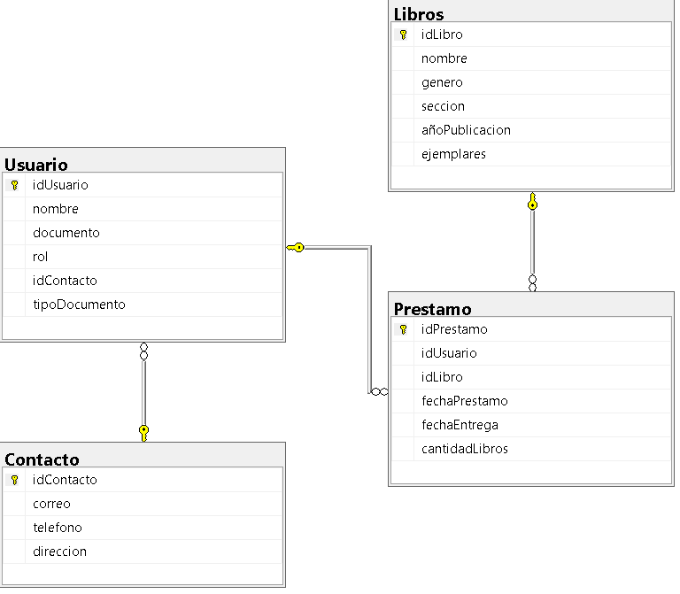

# 📚 Sistema de Préstamo de Libros - Biblioteca CESDE


Sistema web para digitalizar y automatizar la gestión de préstamos de libros de la biblioteca del CESDE.

---

## 📄 Resumen Ejecutivo

### Descripción Técnica del Problema

Actualmente, el préstamo de libros en la biblioteca del CESDE se gestiona de manera manual mediante registros físicos, lo cual genera deficiencias operativas y de seguridad:

- **Falta de trazabilidad:** sin un registro digitalizado no se conoce en tiempo real la ubicación de los ejemplares ni la identidad del usuario responsable, lo que incrementa el riesgo de pérdida o hurto.
- **Ausencia de notificaciones automáticas:** no existe un mecanismo que identifique o avise las fechas de vencimiento, lo que deriva en entregas extemporáneas y retrasos continuos.
- **Errores en la captura de datos:** la toma manual de datos de contacto es lenta y propensa a errores tipográficos, lo que dificulta el cobro, el rastreo y la recuperación de los libros.

### Solución Propuesta

Diseño e implementación de un sistema web de gestión de préstamos con persistencia de datos digitalizada. El sistema permite:

- **Centralización en base de datos relacional:** registro inmediato de los préstamos activos, el inventario de ejemplares y los perfiles de usuario con datos de contacto validados.
- **Control de trazabilidad y estado:** monitoreo en tiempo real del estado de cada libro (`DISPONIBLE`, `PRESTADO`, `EN_MORA`).
- **Gestión de vencimientos:** control de fechas límite que identifica automáticamente los préstamos vencidos y facilita su notificación y recuperación.

### Valor del Sistema

- **Reducción de pérdidas:** meta de mitigar al menos un 80 % de los casos de extravío, deterioro o pérdida no trazable.
- **Optimización operativa:** eliminación del error humano en el registro de datos y menor tiempo de atención en taquilla.
- **Control total del inventario:** visibilidad en tiempo real del 100 % del catálogo físico, con recuperación oportuna de los activos institucionales.

---

## 🏗️ Arquitectura

El sistema sigue una **arquitectura en 3 capas**:

```
┌──────────────────────────────────────────────────────┐
│  CAPA DE PRESENTACIÓN  ·  Vaadin Flow 25             │
│  Interfaces para bibliotecarios y estudiantes        │
├──────────────────────────────────────────────────────┤
│  CAPA DE LÓGICA  ·  Java 25 + Spring Boot            │
│  Reglas de préstamo, validación de inventario, mora  │
├──────────────────────────────────────────────────────┤
│  CAPA DE DATOS  ·  SQL Server 2022                   │
│  Persistencia e integridad referencial               │
└──────────────────────────────────────────────────────┘
```

| Capa | Responsabilidad |
|---|---|
| **Presentación (Frontend)** | Interfaces gráficas e interacción con bibliotecarios y estudiantes mediante Vaadin Flow. |
| **Lógica (Backend)** | Gestión de préstamos, validación de inventarios y cálculo de estados de mora en Java. |
| **Datos (Database)** | Motor relacional SQL Server que garantiza la persistencia e integridad de los datos. |

---

## 📊 Modelo de Datos



---

## 🛠️ Stack Tecnológico

| Componente | Tecnología | Versión |
|---|---|---|
| Lenguaje | Java (JDK) | 25 |
| Framework base | Spring Boot (`spring-boot-starter-parent`) | 4.1.1 |
| Framework de interfaz | Vaadin Flow (`vaadin`, `vaadin-spring-boot-starter`) | 25.3.0 |
| Base de datos | Microsoft SQL Server | 2022 |
| Pruebas | `spring-boot-starter-test`, `browserless-test-spring` | Gestionadas por Spring Boot / Vaadin |
| Gestión de dependencias y build | Apache Maven | Definido por el `pom.xml` |
| Control de versiones | Git / GitHub | - |

> Las versiones de Java, Spring Boot y Vaadin corresponden a las declaradas en el `pom.xml`.

---

## ⚙️ Guía de Configuración

### Pre-requisitos

- Java JDK 25 instalado.
- SQL Server y SQL Server Management Studio (SSMS).
- Git instalado en el equipo.
- Bash instalado en el equipo

### Variables de entorno

Por el momento el proyecto no requiere variables de entorno. Se documentarán aquí cuando se configure la conexión a la base de datos.

### Pasos para ejecución local

1. Clonar el repositorio:

   ```bash
   git clone https://github.com/kathar-cmd/Integradormoviles.git
   ```

---

## 🔄 Flujo de Trabajo

Además de reuniones frecuentes para distribuir las tareas, usamos **Git** y **GitHub**. Los 3 integrantes somos colaboradores del repositorio remoto y enviamos los avances de forma progresiva mediante *commits*, integrando los cambios de cada integrante a través de ramas y *pull requests*.

---

## 📜 Licencia y Créditos

### Equipo de Trabajo

| Rol | Integrante |
|---|---|
| Líder de Proyecto | Miguel Ángel Herrera |
| Desarrollador Colaborador | Juan Lopez |
| Desarrollador Colaborador | Daniel Machado |

### Créditos

El proyecto fue iniciado a partir de la plantilla base proporcionada por el docente de la asignatura. Se configuró un repositorio colaborativo en GitHub para el desarrollo en equipo.

### Licencia

Este proyecto no cuenta con una licencia formal. Es un proyecto académico desarrollado a partir de una plantilla proporcionada por el docente de la asignatura.